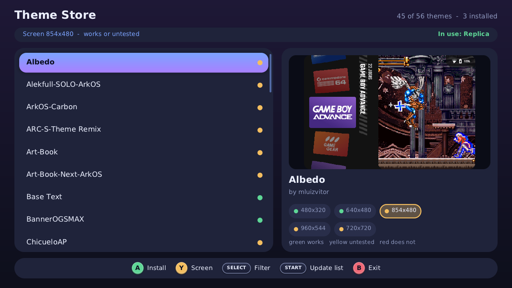
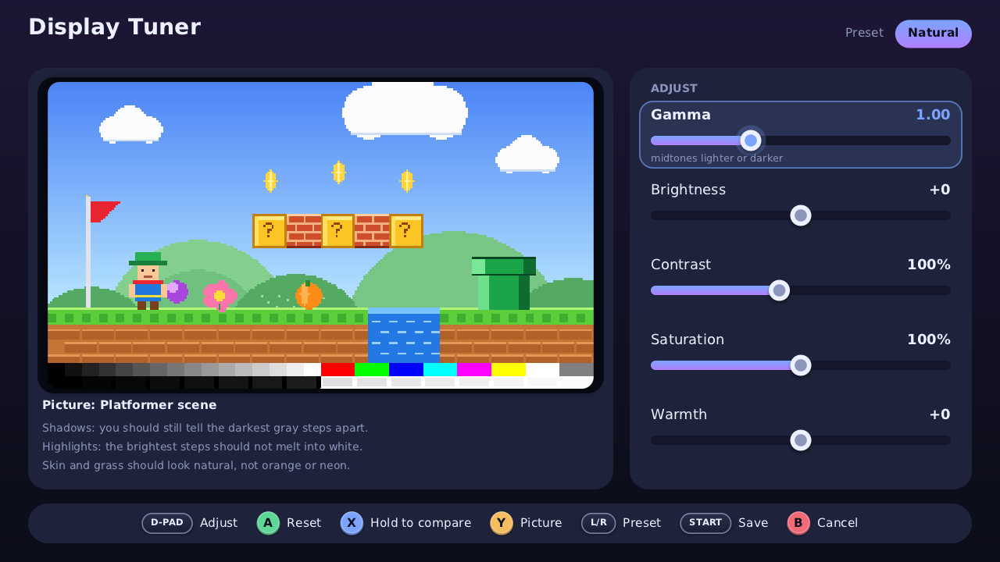

# dArkOS tools

Small, light apps for **dArkOS** handhelds (RG52 Mini, RG43H / RG43V Pro and other RK3562 consoles; made with the EmulationStation Tools menu in mind).
Each one is a launcher script plus a folder: drop both into your Tools folder and open them from **Tools**.

| App | What it does |
|---|---|
| **[Theme Store](ThemeStore/)** | Browse about 55 EmulationStation themes with previews and per-resolution compatibility, install, remove and switch themes from the console. |
| **[Display Tuner](DisplayTuner/)** | Adjust gamma, brightness, contrast, saturation and warmth while looking at a reference picture (or your own screenshot); hold X to compare with the original; the setting is saved and comes back after every boot and game. |

## Install
1. Download the zips from the **[Releases](../../releases)** page (`ThemeStore-tools.zip`, `DisplayTuner-tools.zip`).
2. Put the console's games card in your PC (or use the USB-C cable, which shows the console as a media device) and open the **`tools`** folder of the **EASYROMS** partition (`/roms/tools` on the console).
3. **Extract the zip right into that folder** ("Extract here"), so that for example `Theme Store.sh` and `themestore/` sit **next to each other** directly inside `tools` (not inside another folder).
4. On the console, restart EmulationStation (Start > Quit > Restart EmulationStation) and open **Tools > Theme Store** or **Tools > Display Tuner**.

## Status
**Tested on an RG52 Mini only**, and not yet driven with the pad inside EmulationStation: the screens were rendered and the downloads, installs, display changes and the boot service were exercised on the device from the command line.
Feedback from the RG43H / RG43V and R36S is welcome. Use at your own risk.

## Requirements and notes
- dArkOS (EmulationStation-fcamod) with `curl`, `unzip`, `sudo` and `/opt/inttools/gamecontrollerdb.txt` (all in the image). Theme Store needs Wi-Fi to download.
- The included binaries are aarch64 and need **glibc 2.38 or newer** (the current dArkOS). On an older system the launcher rebuilds from the included source if `gcc` and `libsdl2-dev` are installed.
- **Theme Store** installs themes from their authors' GitHub repositories; the list comes from [Jetup13/Emulationstation-OGA-Theme-Gallery](https://github.com/Jetup13/Emulationstation-OGA-Theme-Gallery). Themes belong to their authors and keep their own licenses. Themes made for ES-DE do not work with this EmulationStation.
- **Display Tuner** uses the display controller's gamma and 3D colour tables. The first **Save** installs a small boot service that re-applies your setting (emulators reset the tables when they start) and turns off the older `gamma-lut.service` of the Gamma / Display adjustment scripts so they do not fight. Press Select then Start to go back to neutral. No game screenshot is bundled; put your own PNG/JPG in `displaytuner/images/`.

## Build from source
Each app builds on the console itself (`make themestore` in `ThemeStore/themestore/`, `make displaytuner` in `DisplayTuner/displaytuner/`; needs `gcc` and `libsdl2-dev`).
`build-zips.sh` makes the release zips from a folder that already contains the built binaries. The `dev/` folders hold the headless renderers and test tools used during development.

## Credits and license
MIT (see `LICENSE`). `stb_image.h` and `stb_truetype.h` are public domain (Sean Barrett). Made by **doster00** together with Claude (Anthropic's AI) for the dArkOS community; dArkOS itself is the work of **mamaich** (`dArkOS_rg52mini`) on top of **christianhaitian**'s dArkOS.

---

## Português
Apps pequenos e leves para o **dArkOS** (RG52 Mini, RG43H / RG43V e outros consoles RK3562): **Theme Store** (loja de temas do ES, com prévia e compatibilidade por resolução) e **Display Tuner** (ajuste de gamma, brilho, contraste, saturação e calor olhando uma imagem de referência; segure X para comparar).
**Instalação:** baixe o zip em *Releases*, abra a pasta `tools` da partição EASYROMS e use **"Extrair aqui"**, de modo que o `.sh` e a pasta do app fiquem lado a lado dentro de `tools`. Reinicie o ES e abra pelo menu **Tools**.
Testado só no RG52 Mini. Uso por sua conta e risco.
